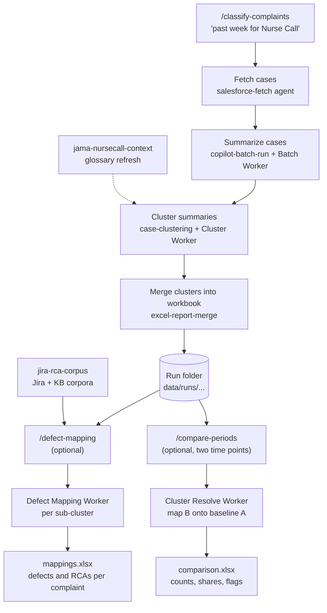

# cc-complaint-analyzer

Classify Nurse Call complaints and link them to the Jira defects and root cause analyses
(RCAs) that would likely have addressed them — all from a **VS Code Copilot session**.
You type a request; Copilot skills fetch cases from Salesforce, summarize and cluster them
with isolated worker agents, and write everything to one run folder under `data\runs\`.
No separate LLM API key is needed: the reasoning is done by Copilot.

## 1. Install

### Codebase

Prerequisites: Python 3.12+, Git, VS Code with GitHub Copilot (agent mode), and the Salesforce
`sf` CLI logged in to your org (`sf org login web`).

```powershell
git clone https://github.com/sobczyd/cc-complaint-analyzer.git
cd cc-complaint-analyzer
python -m venv .venv
.\.venv\Scripts\python.exe -m pip install -e .
.\.venv\Scripts\python.exe -m pip install pytest pytest-asyncio   # only needed to run tests
```

### Skills and agents

Nothing extra to install: the skills (`.github\skills\`) and worker agents (`.github\agents\`)
are part of the repository and are picked up by Copilot when you **open the cloned folder in
VS Code**. Then:

1. Make sure these MCP servers are configured and running in VS Code: `salesforce-local`,
   `jira-local` / Atlassian (needed for defect mapping) and, optionally, `jama-local`
   (glossary refresh).
2. Open Copilot Chat in **agent mode** and type `/` to confirm the skills are listed
   (`/classify-complaints`, `/compare-periods`, `/defect-mapping`, `/powerbi-export`, ...).
3. Optional check: `.\.venv\Scripts\python.exe -m pytest`.

## 2. End-to-end workflow: build the Power BI package

The goal is the `powerbi_export_package\` folder (`FactSource`, `DimID`, `DimCluster`,
`DimDefect`, `DimSummary` Excel files plus a refresh `README.md`) that feeds the Power BI data model. Each
step is one prompt in Copilot Chat; every step writes into the run folder under `data\runs\`.

| Step | What happens | Prompt | Key output |
|---|---|---|---|
| 1. Summarize + classify | Fetch cases from Salesforce, summarize each, cluster the summaries | `/classify-complaints Nurse Call complaints in October 2026, use defaults` | `cases_with_summaries.xlsx`, `clusters\<name>\clusters.xlsx`, `cases_with_clusters.xlsx` |
| 2. Compare (optional) | Compare against another period; resolves cluster names onto the baseline taxonomy | `/compare-periods Sep 2026 (run <a>) vs Oct 2026 (run <b>)` | `data\runs\compare_...\comparison.xlsx` |
| 3. Map defects | Link each complaint to Jira defects / RCAs (builds the Jira/KB corpora first if missing) | `/defect-mapping data\runs\<run-id>\clusters\<name>` | `defects\<name>\mappings.xlsx` |
| 4. Power BI package | Reshape cases into the `salesforce.xlsx` layout and add the dimensions | `/powerbi-export package for data\runs\<run-id>, include the comparison and defect mappings` | `powerbi_export_package\` |

Clusters, comparison and defects are optional inputs to step 4: missing ones give a warning and
an empty dimension. The same step can be run from the CLI:

```powershell
.\.venv\Scripts\python.exe -m complaint_analyzer.workflows.powerbi_export package `
    --run data\runs\<run-id> [--comparison data\runs\compare_<...>] [--clusters <name>] [--defects <name>]
```

### Example prompts

Everything in one go:

```text
/classify-complaints Nurse Call complaints in October 2026, use defaults. When done, run
/defect-mapping on the clusters, then build the powerbi-export package for the run.
```

Add the period comparison:

```text
/compare-periods Sep 2026 (run nurse_call_sep_2026_with_cq_2026-10-20) vs Oct 2026
(run nurse_call_oct_2026_with_cq_2026-10-19). Then create the powerbi-export package for the
October run using that comparison.
```

Re-use a finished run (no re-fetching):

```text
/powerbi-export package --run data\runs\<run-id> --comparison data\runs\compare_<...>
```

## Workflow overview



`/classify-complaints` asks short questions (period, query, batch sizes, glossary) with a
sensible default for each; say "use defaults" to skip them. It can also offer to run
defect mapping at the end.

## Example prompts

| Prompt | Skills / agents used | Result |
|---|---|---|
| `/classify-complaints past week for Nurse Call` | `classify-complaints` → `salesforce-fetch`, `copilot-batch-run` (Batch Worker), `case-clustering` (Cluster Worker), `excel-report-merge` | New run folder with cases, summaries, clusters and `workflow.md` |
| `/classify-complaints Nurse Call complaints in October, use defaults` | same, no questions | Same, with default batch sizes (10 summaries, 100 clustering) |
| `/classify-complaints data\runs\<run-id>` | `classify-complaints` (reuses existing summaries/cases) | Continues from whatever the folder already has |
| `/defect-mapping data\runs\<run-id>\clusters\<name>` | `defect-mapping` → Defect Mapping Worker | `defects\<name>\mappings.xlsx`, `mappings.jsonl`, `summary.json` |
| `/defect-mapping data\runs\<run-id>\clusters\<name> --min-batch 10 --max-batch 20` | `defect-mapping` | Same, with custom batch bounds |
| `/compare-periods Sep 2026 (run <a>) vs Oct 1-19 2026 (run <b>)` | `compare-periods` → Cluster Resolve Worker | `data\runs\compare_...\comparison.xlsx`, `summary.md`, audit files |
| `/compare-periods split data\runs\<run-id> at 2026-10-15` | `compare-periods` (one run, two date ranges) | Same, with no name resolution needed |
| `/powerbi-export package --run data\runs\<run-id>` | `powerbi-export` | `powerbi_export_package\` (FactSource, DimID, DimCluster, DimDefect, DimSummary) |
| `/jira-rca-corpus refresh` | `jira-rca-corpus` | Fresh Jira defect/RCA and KB corpora in `data\jira` and `data\kb` |
| `/jama-nursecall-context update the glossary` | `jama-nursecall-context`, `prompt-author` | Updated clustering glossary (new prompt version) |

### Key outputs in a run folder

| File | Contents |
|---|---|
| `cases_with_summaries.xlsx` | Fetched cases plus generated summaries |
| `clusters\<name>\clusters.xlsx` | Cluster / sub-cluster taxonomy with labels, rationale and cited case numbers |
| `cases_with_clusters.xlsx` | Cases with final cluster and sub-cluster columns |
| `defects\<name>\mappings.xlsx` | Complaint → defect/RCA matches (direct Jira links included) |
| `workflow.md` | Mermaid diagram of what this run did |

`/defect-mapping` needs a finished clustering run and the Jira/KB corpora; it runs
`jira-rca-corpus` first if they are missing. Complaints already linked in Jira by CRM case
number are mapped directly; "none" is the expected answer for hardware, configuration and
no-fault-found complaints.

`/compare-periods` needs a finalized clustering in each period (no defect mapping). Time point A is
the baseline; the later period's sub-clusters are mapped onto it (or flagged NEW) so counts, shares and
cases per day are like for like. Flags: NEW, GONE, and UPTICK / DECLINE (change > 10 cases with at
least 10 cases in one period by default; it asks for the thresholds). The comparison folder holds
`comparison.xlsx`, `summary.md` and the case-level original vs resolved assignments for audit.

## All skills

Skills live in [`.github/skills/`](./.github/skills/).

| Skill | Purpose |
|---|---|
| [`classify-complaints`](./.github/skills/classify-complaints/SKILL.md) | End-to-end fetch → summarize → cluster into one run folder |
| [`defect-mapping`](./.github/skills/defect-mapping/SKILL.md) | Map clustered complaints to Jira defects and RCAs |
| [`compare-periods`](./.github/skills/compare-periods/SKILL.md) | Compare the clusters of two time points (baseline-anchored name resolution, counts, shares, flags) |
| [`powerbi-export`](./.github/skills/powerbi-export/SKILL.md) | Convert cases into the Power BI `salesforce.xlsx` layout and build the data-model package |
| [`jira-rca-corpus`](./.github/skills/jira-rca-corpus/SKILL.md) | Build/refresh Jira defect, RCA and KB corpora |
| [`case-clustering`](./.github/skills/case-clustering/SKILL.md) | Cluster case summaries in batches and merge the taxonomies (tiered group + meta-merge for large runs) |
| [`copilot-batch-run`](./.github/skills/copilot-batch-run/SKILL.md) | Run any registered prompt across isolated Copilot workers |
| [`salesforce-export`](./.github/skills/salesforce-export/SKILL.md) | Export a versioned Salesforce query to Excel |
| [`excel-report-merge`](./.github/skills/excel-report-merge/SKILL.md) | Merge results and clusters back into a cases workbook |
| [`jama-nursecall-context`](./.github/skills/jama-nursecall-context/SKILL.md) | Maintain the clustering glossary from Jama |
| [`prompt-author`](./.github/skills/prompt-author/SKILL.md) | Create or revise a versioned analysis prompt |
| [`salesforce-query-author`](./.github/skills/salesforce-query-author/SKILL.md) | Create or revise a versioned SOQL query |

Prompts (`src\complaint_analyzer\prompts\`) and queries (`src\complaint_analyzer\queries\`)
are immutable versioned `vN.txt` files; use `prompt-author` and `salesforce-query-author`
rather than editing them by hand.

## Repository layout

```text
.github/skills/, .github/agents/   Copilot skills and worker agents
src/complaint_analyzer/            Python helpers that prepare, validate and finalize runs
  workflows/                       classify_complaints, case_cluster, defect_mapping, compare_periods, ...
  prompts/, queries/               versioned prompts and SOQL query sets
data/runs/                         one folder per run (gitignored except examples)
docs/                              architecture, configuration, CLI reference, extending
```

More detail: [docs/architecture.md](./docs/architecture.md),
[docs/cli-reference.md](./docs/cli-reference.md),
[docs/configuration.md](./docs/configuration.md),
[docs/extending.md](./docs/extending.md).

## Tests

```powershell
.\.venv\Scripts\python.exe -m pytest
```
